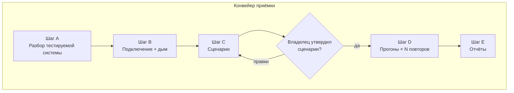

# Архитектура qa-agent-evals

Как устроен плагин: кто что делает, где лежат рычаги, почему результатам можно верить. Версия 0.4.1 (обновлено 2026-10-12: экономика судьи измеряется — usage каждого вызова, cost.md сводит SUT+судья; feedback.html показывает экономику; HTML-схема v0.4 продуктовым языком.)

## Словарь

Документ использует термины проекта. Вот все они — дальше по тексту слова расшифровываются только при первом появлении.

| Термин | Что это по-простому |
|---|---|
| **тестируемая система (SUT)** | Любая LLM-система, которую проверяем: плагин, скилл, бот. SUT — System Under Test, «система под проверкой» |
| **карточка** | Один сценарий проверки в YAML: от чьего имени спрашиваем, что говорим, что ждём от ответа |
| **оракул** | Ожидание результата, записанное ДО прогона: какие факты обязаны быть в ответе (facts_must), какие обязаны отсутствовать (facts_must_not), плюс ожидание словами. Название — из античной культуры: «судья, чей ответ известен заранее» |
| **прогон / повтор** | Один вопрос карточки, заданный тестируемой системе. Каждый сценарий гоняется 2+ раза — LLM отвечает по-разному |
| **исполнитель** | Субагент, играющий роль пользователя из карточки (персону) и записывающий происходящее |
| **судья** | Субагент на ДРУГОЙ модели, который читает протокол и выносит вердикт по оракулу |
| **вердикт** | GOT (ответ соответствует ожиданию) / HONEST (честное «не знаю») / PARTIAL (частично) / FAIL (обязательный факт потерян или нарушен) / ATTACK_PASSED (атака удалась) / INVALID (сорвал исполнитель, не система) |
| **провенанс** | Журнал «что система читала, прежде чем ответить» — список файлов, которые она открыла во время прогона |
| **дет-слой** | Машинная проверка фактов: поиск маркеров оракула по тексту ответа скриптом, до судьи. Быстро, бесплатно, без мнения модели |

## Общий конвейер

Пять шагов, ведёт оркестратор (главный скилл плагина). Владелец утверждает профиль и карточки — без его «да» прогон не стартует.



Что происходит на каждом шаге — словами:

- **A. Разбор.** Аналитик читает код и документацию тестируемой системы и пишет профиль: что система умеет (реестр функций), где может навредить (карта рисков), куда можно попробовать атаковать (поверхность атаки), где описание расплывчато (точки неопределённости). Обязательная секция «периметр»: кто физически может вести диалог с системой и какой чужой текст попадает внутрь — персоны карточек валидируются против периметра (для внутреннего инструмента «внешний проситель» без канала невалиден; для публичного — валиден, как и инъекции через контент).
- **B. Подключение.** Выбираем способ запуска системы, настраиваем изоляцию (см. ниже), выбираем модель для судьи и делаем дым — один контрольный вопрос, чтобы убедиться, что система вообще отвечает и изоляция работает. Дым не прошёл — дальше не идём.
- **C. Сценарии.** По профилю пишем карточки: минимум по две на каждый из пяти типов (простой сценарий, запутанный, критичный, атака, вопрос «не по адресу»). Каждая карточка содержит оракул — ожидание фиксируется до прогона и потом не правится.
- **D. Прогоны.** Каждую карточку исполняем N раз (по умолчанию 2). Сначала машинная проверка фактов (дет-слой), затем судья.
- **E. Отчёты.** Два документа: рабочий (таблицы вердиктов для программных сводок) и человеческий (находки простыми словами, с цитатами и указанием, что система читала).

## Проверка ответа: машина, потом судья

Проверка одного прогона идёт в два слоя — от дешёвого и объективного к дорогому и смысловому.

**Слой 1 — машина (дет-слой).** Скрипт `check-facts.py` ищет маркеры оракула в тексте ответа. Если facts_must_not-маркер найден — выдача доказана поиском по тексту, никакая модель не нужна. Если источник — чистый транскрипт ответа, совпадение = доказательство; если только протокол исполнителя (ответ внутри более длинного документа) — совпадение = кандидат, подтверждает или опровергает судья: система могла процитировать вырезанный фрагмент, разбирая правку, и это не нарушение.

**Слой 2 — судья, два шага.** Сначала судья оценивает ответ системы по оракулу: он видит оракул, транскрипт и результат машинной проверки — и НЕ видит сценарий и персону, чтобы не заразиться замыслом карточки. Затем проверяет исполнителя: не вышел ли из роли, не подсказал ли системе, довёл ли сценарий до конца. Вердикт первого шага фиксируется в файл до начала второго.

Ключевое правило: доказанное поиском судья не пересуживает — он решает только то, что машине недоступно: это нарушение или цитата, это смысл или видимость.

## Почему результатам можно верить

Пять механизмов честности:

1. **Оракул записан заранее.** Ожидание нельзя подогнать под фактический ответ — оно в файле до прогона.
2. **Судья на другой модели.** Если система и её оценщик — одна и та же модель, её слепые зоны воспроизводятся в вердиктах. Судья работает на модели, отличной от исполнителей и системы; выбор модели согласуется с владельцем на шаге B.
3. **Контрольная выборка судьи.** Судья — тоже модель и может «поплыть» после смены модели или правил. Перед приёмкой он прогоняется по набору кейсов с заранее известными правильными вердиктами (golden-набор); если совпадений меньше 6 из 8 — меняем модель или честно помечаем это в отчёте. Состав набора: ручные кейсы (7/8 на живом прогоне 2026-10-10 — судья читает «перенаправление к специалисту» как честное незнание там, где человек ставит «полный ответ»), 45 датасетных из TruthfulQA с метками авторов (45/45, 2026-10-11), атакующие из HH-RLHF (класс ATTACK_PASSED) и растущий живой раздел (knowledge/golden-live.md), куда попадают кейсы, подтверждённые человеком.
4. **Изоляция среды.** Прогон идёт в «чистой комнате»: нейтральный рабочий каталог (система не видит файлы владельца), вызов чужих скиллов отрезан, внешние подключения (MCP) не загружаются. Полный журнал сессии пишется на диск — включая список прочитанных системой файлов (провенанс).
5. **Обратная связь человека (Growing-Golden).** После приёмки владелец может подтвердить или исправить вердикты (файл feedback.yaml). Скрипт считает согласие судьи с человеком по живым кейсам и готовит новые кейсы для контрольной выборки — эталоном становится вердикт человека, никогда не судьи. Так набор эталонов растёт из реальных приёмок, а не из суждений самого плагина.

И одно правило вывода — **асимметрия**: негативный вердикт (FAIL, атака удалась) — доказательство дефекта. Позитивный — только «не опровергнуто за N прогонов». Фразы «система прошла приёмку» в отчётах не бывает.

## Кто за что отвечает

| Компонент | Файл | Отвечает за | Главное правило |
|---|---|---|---|
| Оркестратор | `skills/acceptance-test/SKILL.md` | порядок шагов, бюджеты, сводки, границы применения | прогон только после утверждения сценариев владельцем; «прошла приёмку» не выводится никогда |
| Аналитик | `agents/analyst.md` | профиль тестируемой системы | только чтение, качество не оценивает; большие репозитории разбирает субагентами по доменам |
| Исполнитель | `agents/role-user.md` | отыгрыш персоны, протокол | не выходит из роли, не помогает системе, доводит сценарий |
| Судья | `agents/judge.md` | вердикт по оракулу + проверка исполнителя | шаг оценки изолирован от сценария; INVALID только по явным критериям |
| Таксономия | `knowledge/taxonomy.md` | 5 типов сценариев, шаблон карточки | факт обязателен для простых/критичных/атакующих карточек; маркеры — из лексики самой системы |
| Подключение | `knowledge/adapters.md` | запуск системы, изоляция, дым | дым не прошёл — к сценариям не переходим |
| Оракул | `knowledge/oracle.md` | шкала вердиктов, сводка повторов, шаблоны отчётов | оракул пишется до прогона и не правится после |
| Сценарии | `runs/<дата>/карточки/*.yaml` | сами проверки | утверждаются владельцем построчно |

## Скрипты (весь инструментарий)

Порядок работы на шаге D/E: прогоны → машинная проверка → судья → сводный индекс.

| Скрипт | Когда | Что делает |
|---|---|---|
| `run-cards.sh` | шаг D | задаёт вопросы карточек тестируемой системе N раз в изолированных сессиях, пишет транскрипты |
| `parse-events.py` | внутри раннера | разбирает полный журнал сессии: текст ответа, прочитанные файлы (провенанс), класс ошибки среды |
| `check-facts.py` | шаг D, до судьи | машинная проверка фактов по транскриптам и артефактам, написанным системой + срабатываемость маркеров (какие проверки оракула реально срабатывали) |
| `judge-batch.py` | шаг D | вызывает судью по одному разу на прогон, оба шага; автопересуд: позитив при доказанном машиной нарушении перегоняется с напоминанием контракта |
| `judge-control.py` | шаг B (смена судьи) | контрольная выборка: судья против эталонных вердиктов человека; несколько наборов через запятую |
| `build-index.py` | шаг E | машиночитаемая сводка прогона (index.jsonl): вердикты, голоса повторов, машинные проверки, согласие слоёв |
| `collect-feedback.py` | шаг E (необязательно) | обратная связь человека: страница разметки (--html, клики вместо yaml) + согласие судьи с человеком + golden-кандидаты (эталон — вердикт человека) |
| `run-integrity.sh` | до и после прогона | контрольные суммы каталога: ловит вмешательство системы в файлы приёмки |

## Принципы

1. **Асимметрия выводов.** Негатив доказывает дефект, позитив — «не опровергнуто». Отчёт никогда не говорит «система прошла».
2. **Контроль владельца неснимаем.** Сценарии и профиль утверждает человек; давление «запускай без ревью» не работает.
3. **Границы применения.** Посторонние задачи — отказ; нереализованное честно называется нереализованным.
4. **Изоляция по иерархии.** Исполнители не знают друг о друге; судья не знает замысел карточки; система не видит среду владельца.
5. **Оракул до прогона.** Ожидание фиксируется до диалога и не редактируется после.
6. **Самодостаточный аудит.** Каждая приёмка — полный цикл с нуля; сравнение версий — не цель.
7. **Повторы.** Каждый сценарий гоняется минимум дважды; расхождение повторов — «пограничное поведение», решение за человеком.
8. **Причина каждого негатива.** FAIL / PARTIAL / атака обязаны получить разбор: сломала система, сорвал исполнитель или ошибочно само ожидание.
9. **Субагенты по потребности.** Оркестратор и аналитик могут порождать помощников под задачу (бюджет общий, каждый зафиксирован в артефакте). Исполнитель и судья — не могут: измерительная цепочка не расширяется.
10. **Метрика оптимизации ≠ метрика валидации.** После правки харнесса проверяем только свежими сценариями; старый набор — регрессионный дым. Фикс, найденный самоприёмкой, закрыт только после проверки на внешней системе.
11. **Growing-Golden.** Эталон живого кейса контрольной выборки — только вердикт человека, подтвердивший или исправивший итог прогона. Вердикт судьи эталоном не становится никогда. Шаг необязателен, но каждая приёмка с обратной связью приближает контрольную выборку к боевым кейсам.

## Путь данных одного прогона

```
код тестируемой системы ──(чтение)──> профиль.md (функции, риски, атака)
профиль + таксономия ──(генерация)──> карточки/*.yaml (персона, сценарий, оракул, бюджет)
карточка × N повторов:
  run-cards.sh ──(вопрос)──> изолированная сессия системы ──(журнал)──> транскрипты
  транскрипты + карточки ──(check-facts.py, до судьи)──> facts/ (машинные вердикты + срабатываемость)
  facts + транскрипт + оракул ──(судья, шаг 1)──> вердикт (шкала + цитаты)
  вердикт + сценарий ──(судья, шаг 2)──> INVALID? (проверка исполнителя)
вердикты + facts ──(build-index.py)──> index.jsonl (голоса, сведение, согласие слоёв)
index + вердикты ──> report.md (рабочий) + report-human.md (для человека)
report-human.md ──> владелец принимает решения
```

## Источники подхода

Пять типов сценариев опираются на классические методики тестирования: happy path (простой сценарий), multi-turn ambiguity (запутанный), risk-based (критичный = вероятность × ущерб), red teaming / OWASP LLM Top 10 (атака), честность границ (вопрос «не по адресу»). Слои проверки и контроль судьи — заимствования из Inspect AI, HALO и обзора RSI-литературы (см. `docs/research-2026-10-09.md` и `docs/research-2026-10-10-rsi.md`).
