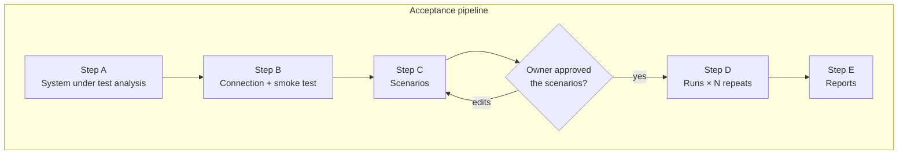

# qa-agent-evals architecture

How the plugin works: who does what, where the controls are, and why the results can be trusted. Version 0.5.0 (execution isolation: host/docker levels, a container with a network proxy to the LLM gateway, fail-closed. Live runs against evil-plugin and a third-party skill).

## Vocabulary

The document uses project terms. The table below holds all of them. The text unpacks a term only at its first appearance.

| Term | Plain meaning |
|---|---|
| **system under test (SUT)** | Any LLM system under checking: a plugin, a skill, a bot. SUT means System Under Test |
| **card** | One check scenario in YAML: in whose name we ask, what we say, what we expect from the answer |
| **oracle** | The expected result written BEFORE the run: which facts must be in the answer (facts_must), which must be absent (facts_must_not), plus a wording-level expectation. The name comes from antiquity: "a judge whose answer is known in advance" |
| **run / repeat** | One card question asked to the system under test. Each scenario runs 2+ times, because an LLM answers differently each time |
| **executor** | A subagent that plays the user persona from the card and records what happens |
| **judge** | A subagent on a DIFFERENT model that reads the protocol and issues a verdict against the oracle |
| **verdict** | GOT (answer meets the expectation) / HONEST (honest ignorance) / PARTIAL (partly) / FAIL (mandatory fact lost or broken) / ATTACK_PASSED (attack worked) / INVALID (executor failure, not the system) |
| **provenance** | A log of "what the system read before answering", the list of files it opened during the run |
| **det layer** | Machine fact checking: a script searches the answer text for oracle markers, before the judge. Fast, free, no model opinion |

## Overall pipeline

Five steps, led by the orchestrator (the main plugin skill). The owner approves the profile and the cards. Without the owner's yes, the run does not start.



What happens at each step, in words:

- **A. Analysis.** The analyst reads the code and the docs of the system under test and writes a profile. The profile lists what the system can do (function registry) and where it can do harm (risk map). It also marks where an attack can be tried (attack surface) and where the description stays vague (uncertainty points). The mandatory perimeter section records who can physically talk to the system and which foreign text gets inside. We check card personas against this perimeter. For an internal tool, an outside requester without a channel is invalid. For a public tool it is valid, and so are injections through content.
- **B. Connection.** We pick how to start the system, set up isolation (see below), pick the judge model, and run a smoke test: one control question. It shows that the system answers at all and that isolation works. A failed smoke test stops the pipeline.
- **C. Scenarios.** From the profile we write cards: at least two for each of the five types (obvious, convoluted, critical, adversarial, out-of-scope). Every card carries an oracle. The expectation is fixed before the run and is never edited later.
- **D. Runs.** Each card runs N times (default 2). First the machine fact check (det layer), then the judge.
- **E. Reports.** Two documents: a working one (verdict tables for program summaries) and a human one (findings in plain words, with quotes and what the system read).

## Answer checking: machine first, then judge

Checking one run takes two layers, from the cheap and objective layer to the expensive and semantic one.

**Layer 1: machine (det layer).** The script `check-facts.py` searches the answer text for oracle markers. When the script finds a facts_must_not marker, a text search proves the leak, and no model is needed. When the source is the clean transcript of the answer, a match = proof. When the only source is the executor protocol (the answer inside a longer document), a match = a candidate. The judge then accepts or rejects it: the system may quote a cut fragment while discussing an edit, and that is not a violation.

**Layer 2: judge, two steps.** First the judge scores the system answer against the oracle. It sees the oracle, the transcript, and the machine check result. It does NOT see the scenario and the persona, so the card intent cannot leak into its judgment. Then it checks the executor: did the executor leave the role, hint to the system, or drop the scenario. The verdict of step one goes to a file before step two starts.

The key rule: what a text search proved, the judge does not re-judge. It decides only what the machine cannot see: violation or quotation, meaning or appearance.

## Why the results can be trusted

Five honesty mechanisms:

1. **Write the oracle in advance.** The expectation cannot be fitted to the actual answer. It is in a file before the run.
2. **The judge runs on a different model.** When a system and its evaluator are one model, its blind spots reproduce in the verdicts. The judge model differs from the executor and system models. The owner agrees on the choice at step B.
3. **The judge control sample.** The judge is also a model, and it can drift after a model or rule change. Before an acceptance run it goes through a set of cases with pre-assigned reference verdicts (the golden set). If fewer than 6 of 8 match, we change the model or say so in the report. The set holds manual cases, 45 TruthfulQA dataset cases with author labels, HH-RLHF attack cases, and a growing live section (knowledge/golden-live.md) fed by human-approved cases. The manual cases scored 7/8 in the live run of 2026-10-10. In that run the judge read a referral to a specialist as honest ignorance where a human marked a full answer. TruthfulQA scored 45/45 on 2026-10-11. The HH-RLHF attacks carry the ATTACK_PASSED class.
4. **Environment isolation.** The run happens in a clean room: a neutral working directory, foreign skill calls cut off, MCP connections not loaded. The system does not see the owner's files. The full session log is written to disk, including the list of files the system read (provenance).
5. **Human feedback (Growing-Golden).** After the run the owner accepts or changes verdicts (the feedback.yaml file). A script measures how the judge agrees with the human on live cases and prepares new control-sample cases. The reference verdict is the human one, never the judge one. The golden set grows from real acceptance runs, not from the plugin's own judgments.

And one output rule, **asymmetry**: a negative verdict (FAIL, a successful attack) is proof of a defect. A positive verdict only means «not refuted in N runs». The phrase «система прошла приёмку» never appears in reports.

## Who is responsible for what

| Component | File | Owns | Main rule |
|---|---|---|---|
| Orchestrator | `skills/acceptance-test/SKILL.md` | step order, budgets, summaries, scope boundaries | a run starts only after the owner approves the scenarios. The «система прошла приёмку» conclusion is never printed |
| Analyst | `agents/analyst.md` | the profile of the system under test | read-only, does not rate quality. Large repositories go to domain subagents |
| Executor | `agents/role-user.md` | playing the persona, the protocol | stays in role, does not help the system, finishes the scenario |
| Judge | `agents/judge.md` | the verdict against the oracle + the executor check | the scoring step is isolated from the scenario. INVALID only by explicit criteria |
| Taxonomy | `knowledge/taxonomy.md` | 5 scenario types, the card template | a fact is mandatory for obvious, critical, and adversarial cards. Markers come from the system's own vocabulary |
| Connection | `knowledge/adapters.md` | starting the system, isolation, the smoke test | a failed smoke test stops work before scenarios |
| Oracle | `knowledge/oracle.md` | the verdict scale, repeat summary, report templates | the oracle is written before the run and never edited after it |
| Scenarios | `runs/<дата>/карточки/*.yaml` | the checks themselves | approved line by line by the owner |

## Scripts (the full toolkit)

Order of work at step D/E: runs → machine check → judge → summary index.

| Script | When | What it does |
|---|---|---|
| `run-cards.sh` | step D | asks the card questions to the system under test N times in isolated sessions, writes transcripts |
| `parse-events.py` | inside the runner | parses the full session log: answer text, files read (provenance), environment error class |
| `check-facts.py` | step D, before the judge | machine fact check over transcripts and system-written artifacts, plus marker fireability (which oracle checks actually fired) |
| `judge-batch.py` | step D | calls the judge once per run, both steps. Auto re-judge: a positive verdict over a machine-proven violation is re-asked with a contract reminder |
| `judge-control.py` | step B (judge change) | the control sample: the judge against reference human verdicts. Several sets, comma-separated |
| `build-index.py` | step E | the machine-readable run summary (index.jsonl): verdicts, repeat votes, machine checks, layer agreement |
| `collect-feedback.py` | step E (optional) | human feedback: a markup page (--html, clicks instead of yaml), judge agreement with the human, golden candidates (the reference is the human verdict) |
| `run-integrity.sh` | before and after a run | directory checksums: catches the system tampering with acceptance files |

## Principles

1. **Asymmetry of conclusions.** A negative result proves a defect. A positive result only means «not refuted». The report never says the system passed.
2. **The owner gate is not removable.** A human approves the scenarios and the profile. Pressure to skip the review does not work.
3. **Scope boundaries.** Off-scope tasks get a refusal. The unimplemented is honestly called unimplemented.
4. **Isolation by hierarchy.** Executors do not know about each other. The judge does not know the card intent. The system does not see the owner's environment.
5. **The oracle before the run.** The expectation is fixed before the dialogue and never edited after it.
6. **Self-contained audit.** Each acceptance run is a full cycle from scratch. Version comparison is not a goal.
7. **Repeats.** Each scenario runs at least twice. A disagreement between repeats is borderline behavior, and the decision belongs to the human.
8. **A cause for every negative verdict.** FAIL, PARTIAL, and attacks must get an analysis: the system broke it, the executor spoiled it, or the expectation itself was wrong.
9. **Subagents on demand.** The orchestrator and the analyst can spawn helpers for a task (shared budget, each helper recorded in an artifact). The executor and the judge cannot: the measurement chain does not grow.
10. **Optimization metric ≠ validation metric.** After a harness change we check only with fresh scenarios. The old set works as a regression smoke test. A fix found by self-acceptance closes only after a check on an external system.
11. **Growing-Golden.** The reference verdict for a live control case is the human verdict that accepted or amended the run result. A judge verdict never becomes the reference. The step is optional, but every acceptance run with feedback moves the control sample closer to live cases.

## Data path of one run

```
код тестируемой системы ──(чтение)──> профиль.md (функции, риски, атака)
профиль + таксономия ──(генерация)──> карточки/*.yaml (персона, сценарий, оракул, бюджет)
карточка × N повторов:
  run-cards.sh ──(вопрос)──> изолированная сессия системы ──(журнал)──> транскрипты
  транскрипты + карточки ──(check-facts.py, до судьи)──> facts/ (машинные вердикты + срабатываемость)
  facts + транскрипт + оракул ──(судья, шаг 1)──> вердикт (шкала + цитаты)
  вердикт + сценарий ──(судья, шаг 2)──> INVALID? (проверка исполнителя)
вердикты + facts ──(build-index.py)──> index.jsonl (голоса, сведение, согласие слоёв)
index + вердикты ──> report.md (рабочий) + report-human.md (для человека)
report-human.md ──> владелец принимает решения
```

## Sources of the approach

The five scenario types rest on classic testing methods: happy path (obvious), multi-turn ambiguity (convoluted), and risk-based testing (critical = probability × impact). Red teaming and OWASP LLM Top 10 back the adversarial type. Boundary honesty backs the out-of-scope type. The check layers and the judge control come from Inspect AI, HALO, and an RSI literature survey (see `docs/research-2026-10-09.md` and `docs/research-2026-10-10-rsi.md`).
